# EKG-Auswertung · ECG Analysis

**[Deutsch](#deutsch) · [English](#english)**

Browser-App (PWA) zur **lokalen** Auswertung von 1-Kanal-EKGs des Viatom **Pulsebit EX** (CheckMe / Lookee) –
Messwerte, Schlaganalyse und KI-Zweitmeinung, ohne Cloud. ·
Progressive web app for **on-device** analysis of single-lead ECGs from the Viatom **Pulsebit EX** (CheckMe / Lookee) –
measurements, beat analysis and an AI second opinion, no cloud.

> ⚠️ **Kein Medizinprodukt – keine ärztliche Diagnose.** Bei Brustschmerz, Atemnot, Lähmungen oder Ohnmacht: **112**.
> ⚠️ **Not a medical device – no medical diagnosis.** In case of chest pain, shortness of breath, paralysis or fainting call your local emergency number (**112 / 911**).

---

## Deutsch

### Funktionen
| Bereich | Umsetzung |
|---|---|
| Daten vom Gerät | **Bluetooth** (Web Bluetooth) direkt vom Pulsebit EX · **USB** (WebHID, experimentell) · Rohdatei · CSV |
| ViHealth-PDF | Rekonstruiert die EKG-Kurve aus dem PDF-Bericht der Hersteller-App (±20 ms / ±0,05 mV) |
| Vermessung | Filter 0,5–40 Hz + 50-Hz-Kerbe, R-Zacken, Medianschlag, P, PR, QRS, QT, QTc (Bazett/Fridericia), ST, T, HRV, Signalqualität |
| Schlaganalyse | Jeder Schlag: normal / SVES / VES / unklar · Bigeminus, Trigeminus, Couplets, Salven, Pausen |
| Rhythmus | Sinusrhythmus, Brady-/Tachykardie (altersgerecht), Sinusarrhythmie, Vorhofflimmern, Tachykardie ohne P-Wellen u. a. |
| KI | **ECGFounder** 1-Kanal (MIT, 150 Labels), lokal per ONNX Runtime Web (WebGPU/WASM); nur Rhythmus-Labels werden gezeigt |
| Befunde | Erklärung, Bedeutung, Empfehlung, Belege, Sicherheitsstufe und **„Wie verlässlich?“** je Befund |
| Personen | Mehrere Personen (Name; optional Geschlecht und Geburtsdatum), Zuordnung, Filter, Pulsebit-Benutzer A/B |
| Sprachen | Deutsch, English, Français, Español, Italiano, Nederlands, Polski, Türkçe |
| PWA | Installierbar, offline nutzbar, Update-Hinweis bei neuer Version |
| Datenschutz | Alle Daten bleiben im Browser (IndexedDB). Keine Server, kein Tracking |

### Screenshots
<p align="center">
  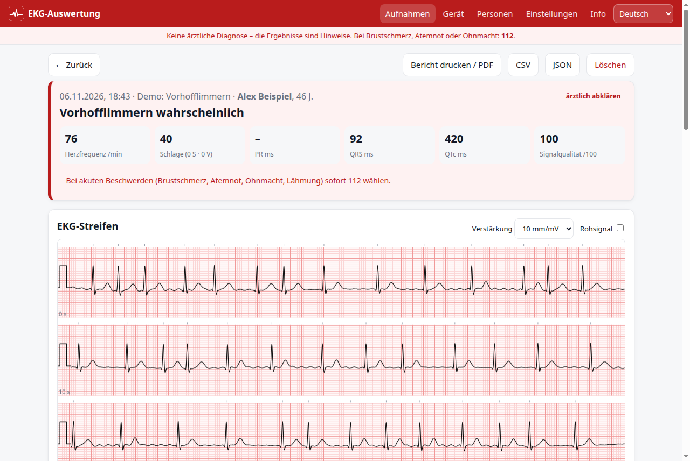
  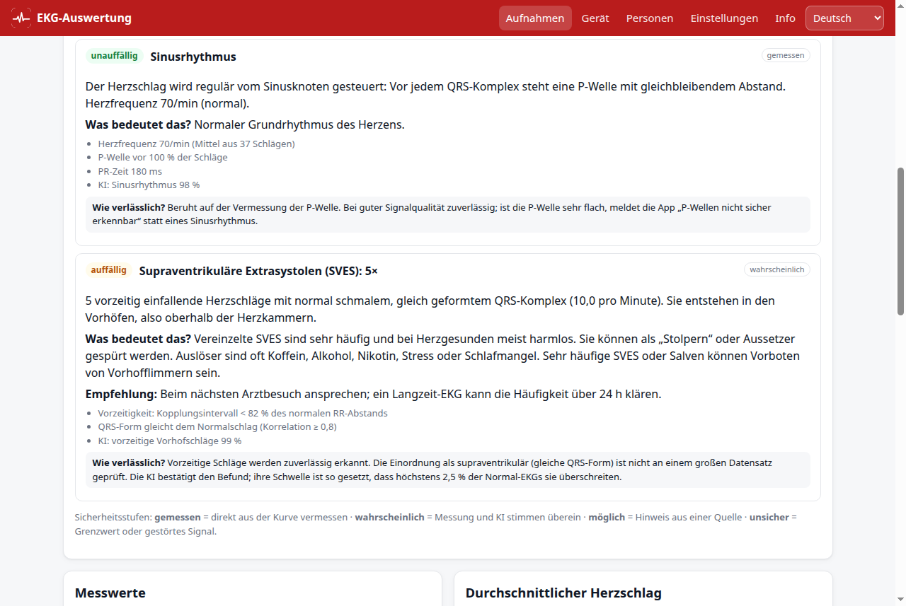
</p>
<p align="center">
  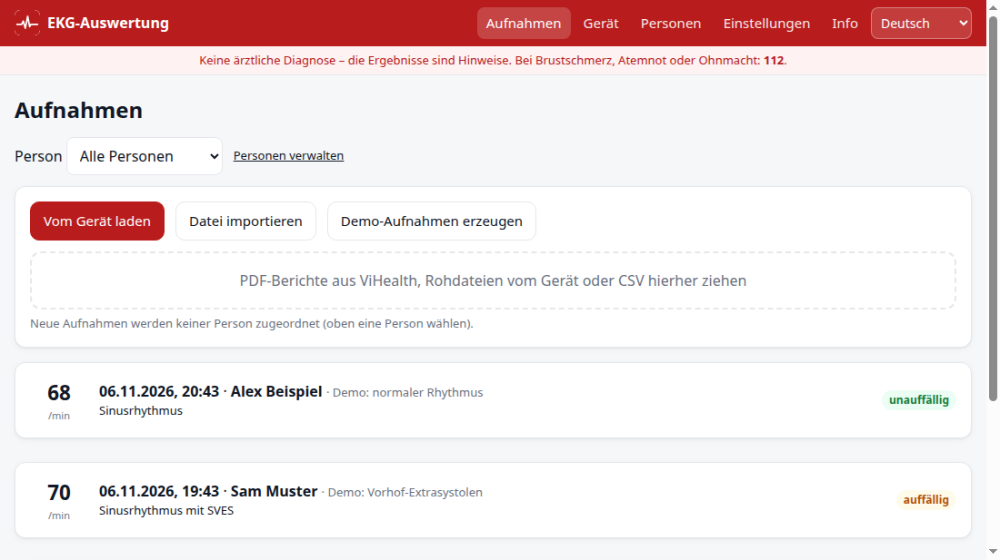
  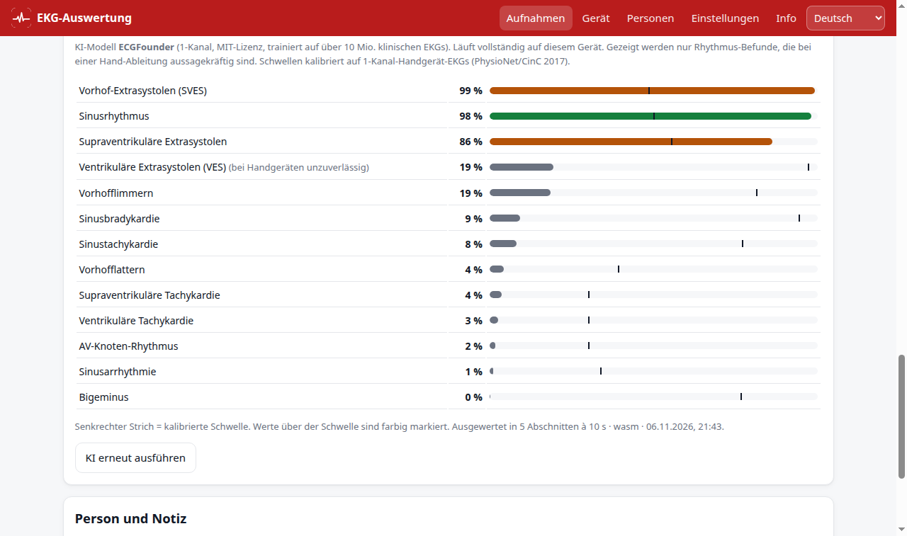
</p>
<p align="center">
  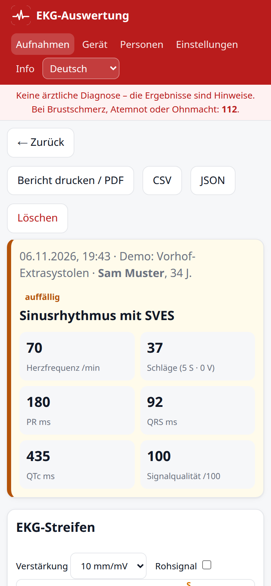
  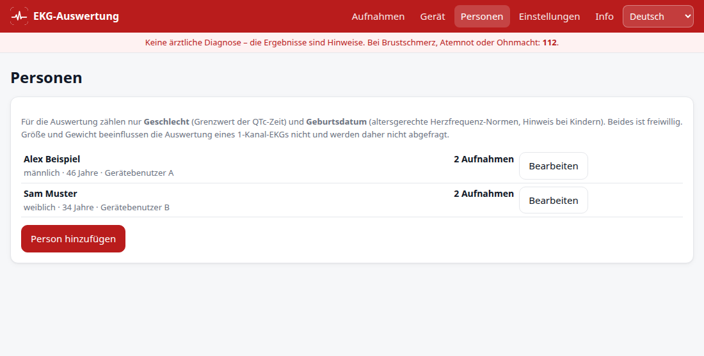
</p>

<sub>Alle Screenshots zeigen synthetische Demo-EKGs und erfundene Personen – keine echten Daten.</sub>

### Genauigkeit (Vorhofflimmern)
Geprüft an 3.537 ärztlich annotierten 1-Kanal-Handgerät-EKGs (PhysioNet/CinC Challenge 2017):

| Verfahren | Sensitivität | Spezifität |
|---|---|---|
| Messung allein | 77 % | 91 % |
| KI allein (Schwelle 0,81) | 88 % | 95 % (AUC 0,974) |
| **Kombination (App)** | **87 %** | **96 %** |
| Stufe „wahrscheinlich“ | 70 % | 98 % (richtig in ~92 %) |

Extrasystolen und Zeiten (PR/QRS/QT) sind nicht gegen ärztliche Vermessung validiert – die App sagt das bei jedem Befund.
KI-Labels, die bei Handgeräten unzuverlässig sind (Schenkelblock, Hypertrophie, Lagetyp, AV-Block), werden nicht angezeigt.

### Nutzen
- **Online:** GitHub-Pages-Adresse dieses Repositorys öffnen (Chrome/Edge; iPhone: Safari für Import, Bluetooth nur mit der App „Bluefy“).
- **Installieren:** Menü „App installieren“ bzw. iPhone: Teilen → „Zum Home-Bildschirm“.
- **Lokal:** `python3 -m http.server 8765` im Projektordner, dann `http://localhost:8765`.

| Plattform | Bluetooth | USB | Import, Auswertung, KI |
|---|---|---|---|
| Linux / Windows / macOS – Chrome, Edge | ✔ | ✔ (experimentell) | ✔ |
| Android – Chrome | ✔ | – | ✔ |
| iPhone/iPad – Safari | – | – | ✔ |
| iPhone/iPad – Bluefy | ✔ | – | ✔ |

### Veröffentlichen & Updates
1. Repository auf GitHub anlegen, pushen, unter *Settings → Pages* „Deploy from branch“ (`main`, `/`) wählen.
2. Für eine neue Version: `node tools/release.mjs patch` (setzt Version, erneuert die Dateiliste des Service Workers), committen, pushen.
   Installierte Apps erkennen die neue Version beim nächsten Start bzw. stündlich und bieten „Jetzt aktualisieren“ an.

### Checkme Browser Pro unter Linux (Wine)
```bash
tools/linux/checkme-browser.sh install <Pfad zum Setup.exe>
sudo cp tools/linux/70-viatom-pulsebit.rules /etc/udev/rules.d/ && sudo udevadm control --reload && sudo udevadm trigger
tools/linux/checkme-browser.sh usb   # prüft, ob das Gerät erkannt wird (am Gerät „Einstellungen → Zum PC“)
tools/linux/checkme-browser.sh       # starten
```

### Entwicklung
- Kein Build-Schritt: reine ES-Module. Tests: `node test/run.mjs`, Browser-Test: `python3 test/cdp.py http://localhost:8765/test/e2e.html --profile /tmp/p --wait "/FERTIG/.test(document.body.innerText)" --eval "document.body.innerText"`.
- Übersetzungen: `js/locales/<sprache>.js` (Vorlage `de.js`, gleiche Schlüssel, Platzhalter `{…}` beibehalten).
- KI-Modell neu erzeugen: `python tools/ecgfounder/convert.py 1_lead_ECGFounder.pth models/ecgfounder-1lead.onnx`.
- Kalibrierung: `tools/calibration/` (PhysioNet/CinC 2017).
- Screenshots neu erzeugen (synthetische Daten): `tools/screenshots.sh`.

---

## English

### Features
| Area | Implementation |
|---|---|
| Device data | **Bluetooth** (Web Bluetooth) directly from the Pulsebit EX · **USB** (WebHID, experimental) · raw file · CSV |
| ViHealth PDF | Reconstructs the ECG trace from the vendor app's PDF report (±20 ms / ±0.05 mV) |
| Measurements | 0.5–40 Hz filter + 50 Hz notch, R peaks, median beat, P, PR, QRS, QT, QTc (Bazett/Fridericia), ST, T, HRV, signal quality |
| Beat analysis | Every beat: normal / PAC / PVC / unclear · bigeminy, trigeminy, couplets, runs, pauses |
| Rhythm | Sinus rhythm, brady-/tachycardia (age-adjusted), sinus arrhythmia, atrial fibrillation, tachycardia without P waves, … |
| AI | **ECGFounder** single-lead (MIT, 150 labels), on-device via ONNX Runtime Web (WebGPU/WASM); only rhythm labels are shown |
| Findings | Explanation, meaning, recommendation, evidence, certainty level and **"How reliable?"** for every finding |
| People | Multiple people (name; optional sex and date of birth), assignment, filter, Pulsebit users A/B |
| Languages | Deutsch, English, Français, Español, Italiano, Nederlands, Polski, Türkçe |
| PWA | Installable, works offline, update prompt when a new version is published |
| Privacy | All data stays in the browser (IndexedDB). No servers, no tracking |

### Screenshots
<p align="center">
  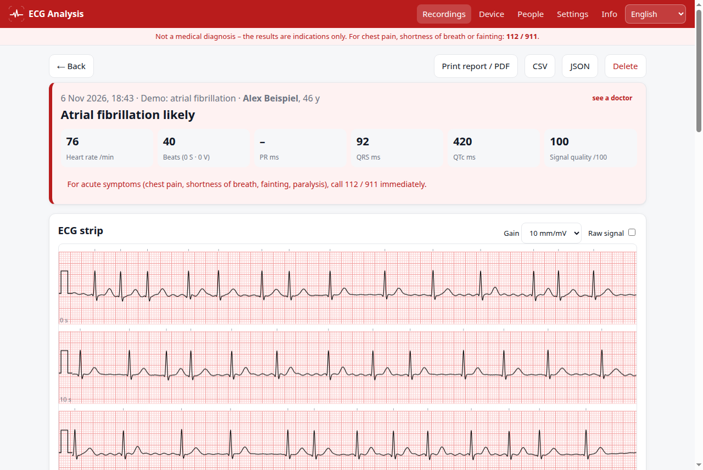
  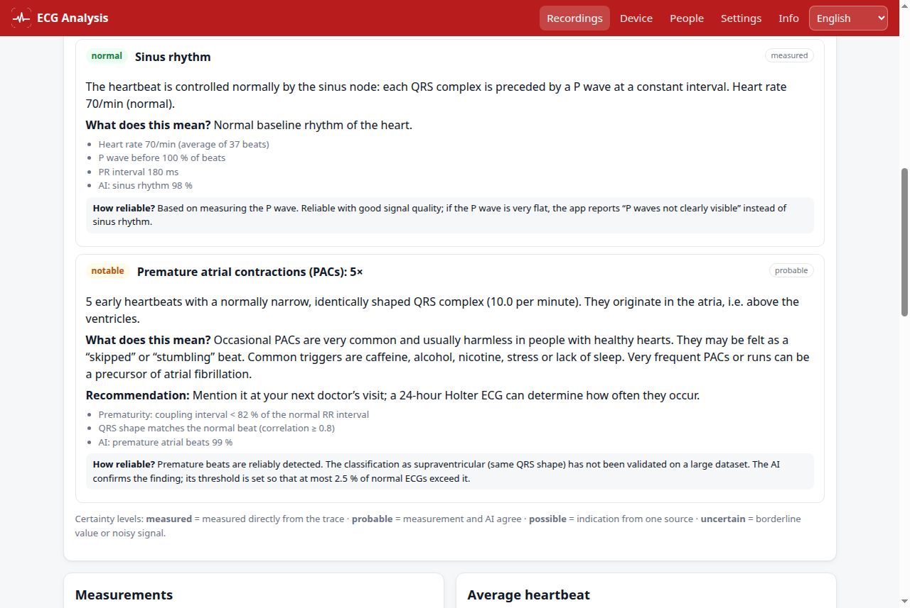
</p>
<p align="center">
  
  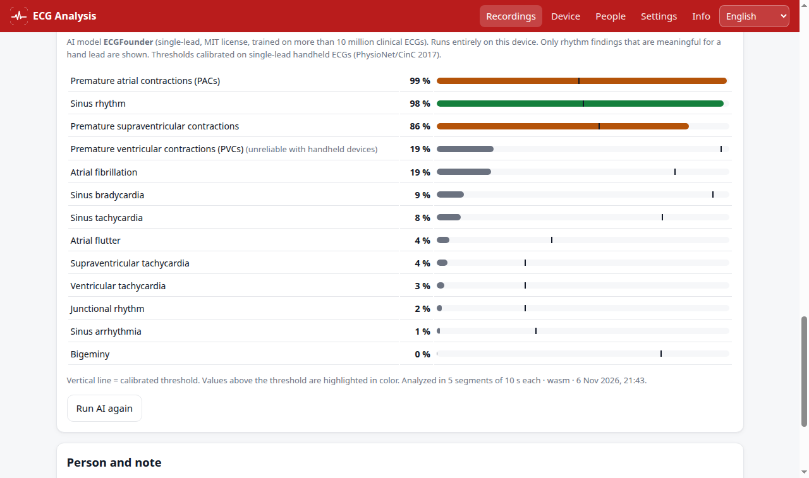
</p>
<p align="center">
  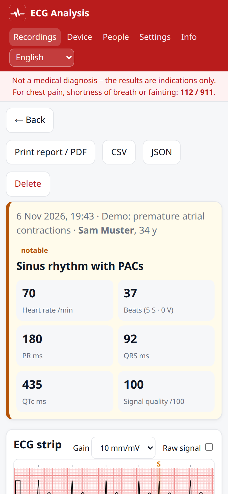
  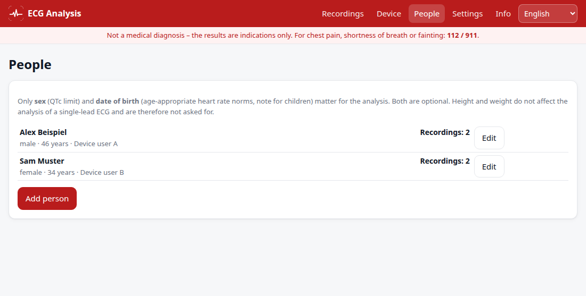
</p>

<sub>All screenshots show synthetic demo ECGs and fictitious people – no real data.</sub>

### Accuracy (atrial fibrillation)
Evaluated on 3,537 physician-annotated single-lead handheld ECGs (PhysioNet/CinC Challenge 2017):

| Method | Sensitivity | Specificity |
|---|---|---|
| Measurements only | 77 % | 91 % |
| AI only (threshold 0.81) | 88 % | 95 % (AUC 0.974) |
| **Combination (app)** | **87 %** | **96 %** |
| "Probable" level | 70 % | 98 % (correct in ~92 %) |

Premature beats and intervals (PR/QRS/QT) are not validated against physician measurements – the app states this for each finding.
AI labels that are unreliable for handheld devices (bundle branch block, hypertrophy, axis, AV block) are not shown.

### Usage
- **Online:** open this repository's GitHub Pages URL (Chrome/Edge; iPhone: Safari for import, Bluetooth only with the "Bluefy" app).
- **Install:** browser menu "Install app", or on iPhone: Share → "Add to Home Screen".
- **Locally:** `python3 -m http.server 8765` in the project folder, then `http://localhost:8765`.

| Platform | Bluetooth | USB | Import, analysis, AI |
|---|---|---|---|
| Linux / Windows / macOS – Chrome, Edge | ✔ | ✔ (experimental) | ✔ |
| Android – Chrome | ✔ | – | ✔ |
| iPhone/iPad – Safari | – | – | ✔ |
| iPhone/iPad – Bluefy | ✔ | – | ✔ |

### Publishing & updates
1. Create a GitHub repository, push, and enable *Settings → Pages* "Deploy from branch" (`main`, `/`).
2. For a new version: `node tools/release.mjs patch` (sets the version and refreshes the service-worker file list), commit, push.
   Installed apps detect the new version on next start (and hourly) and offer "Update now".

### Device protocol (short)
- BLE service `14839ac4-7d7e-415c-9a42-167340cf2339`, write `8b00ace7-…`, notify `0734594a-…`
- Request `AA cmd ~cmd seq(2) len(2) payload crc8`, response `55 status ~status seq(2) len(2) data crc8` (CRC-8, poly 0x07)
- Commands: `0x14` info (JSON), `0x16` set time, `0x03/0x04/0x05` read file (start/chunk/end)
- `1dlc.dat`: record list (17 bytes each); recordings `yyyyMMddHHmmss`: 44-byte header, HR per second, int16 waveform (250 Hz, ×0.001282 mV)
- Source: the public Lepu/Viatom SDK. See [js/device/viatom-protocol.js](js/device/viatom-protocol.js), [js/import/pulsebit-file.js](js/import/pulsebit-file.js)

### Project structure
```
index.html, styles.css, sw.js, manifest.webmanifest
js/app.js              UI                      js/i18n.js, js/locales/   translations
js/dsp/                filters, analysis       js/findings.js            findings & reliability
js/ai/                 ECGFounder (worker)     js/device/                protocol, BLE/USB
js/import/             PDF, Pulsebit, CSV      js/demo.js                synthetic ECGs
tools/                 model conversion, calibration, Wine/udev, release
test/                  node tests, browser test (CDP)
```

### Licenses & sources
- This project: MIT (see [LICENSE](LICENSE))
- ECGFounder model & code: MIT (PKUDigitalHealth) – [models/README.md](models/README.md)
- ONNX Runtime Web: MIT (Microsoft) · pdf.js: Apache-2.0 (Mozilla)
- QRS detection inspired by NeuroKit2 (MIT) · calibration data: PhysioNet/CinC Challenge 2017 (ODC-BY)

Not affiliated with Viatom, Lepu, CheckMe or ViHealth.
